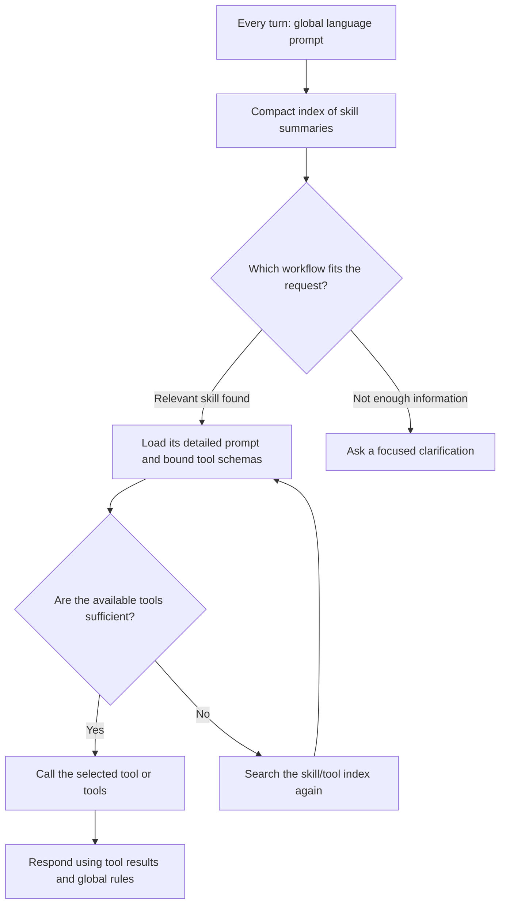

# Tool, skill, and prompt architecture

## Purpose

This note records the intended direction for organizing Bharat OAN's model-facing instructions and tools. It is a design document, not a claim that the current checkout already implements this structure. The v2 chat implementation is on `feat/skill_breakdown_v2`, including `bh-dev` at `d8dd247`. Its usage guide is [skills.md](skills.md).

The target is a shared chat/voice implementation with one tool registry and skill catalogue, separate Agrinet agent configuration, and optional voice-specific skill prompts. This note describes the target; it does not assume that the existing repositories already have identical tools or behavior.

The design should make it straightforward to add and review a workflow, let the agent discover relevant workflows and tools, support loading everything or only a chosen subset, and keep common requests fast. It should also leave room for a more autonomous agent loop later without requiring a second organizational hierarchy now.

## Decisions and terminology

### Agent prompt

Each agent has a language-specific root prompt (for example, `chat/agrinet_en.md` and `voice/agrinet_en.md`). It owns rules that apply to every Agrinet answer: language and tone, response structure, safety, clarification behavior, and other conversation-wide policy.

It should not contain workflow-specific instructions, tool-routing tables, tool schemas, or duplicated descriptions of individual services. Those belong with the relevant skill or tool. This keeps the root prompt small and prevents a workflow edit from silently changing the global instructions.

There is no need for an extra `core/` directory just to hold this prompt. `chat/agrinet_<language>.md` and `voice/agrinet_<language>.md` are clear homes for each agent’s global instructions. Chat may use headings, tables, and links; voice needs spoken phrasing, concise responses, and appropriate handling of numbers and interruptions.

### Skill

A skill is a user-facing workflow package: it explains when a workflow applies and how to carry it out. Examples might include checking PM-KISAN payment status, understanding PMFBY coverage, or comparing mandi prices.

“Skill” is the agent-facing unit of progressive disclosure. It is not another name for Agrinet, a tool, or a capability layer. A folder such as `skills/pm_kisan/payment_status/` groups the workflow under its service. An additional `capabilities/agrinet/` hierarchy is unnecessary in the proposed layout.

Each skill needs two levels of information:

1. A short, always-indexable description that helps the agent decide whether the skill is relevant.
2. Detailed, language-specific instructions that are loaded when the skill is selected.

Keep those two levels together in the language-specific skill document, using front matter for the short description and the document body for the detailed workflow. The loader can read the front matter to build the compact, localized discovery index without loading the body. Do not add a separate `SKILL.md` that repeats the same information in another place. A non-language-specific manifest holds the tool bindings and loading metadata described below.

### Tools

A tool is an executable operation with a name, schema, implementation, and concise model-facing description. Its schema and executable implementation remain in the tool code; a skill references tools by stable names rather than copying their schemas or implementation details into prompt text.

Chat and voice share the same tool implementations, schemas, and registry. Channel-specific agent configuration controls which of those tools are exposed. A tool may support more than one skill, and a skill may use more than one tool. This is a many-to-many relationship, declared in the manifest. Shared tools do not force unrelated workflows into one large skill.

### No separate capability layer for now

Do not introduce a runtime “capability” layer between skills and tools. That would create another term and another set of bindings to maintain without adding a demonstrated need. Use domain folders for navigation and skills for workflow-level instructions.

If later evidence shows that the agent needs a distinct planning/routing object above skills—for example, a weather planner that must choose among several weather workflows—that can be introduced as an explicit discovery feature. It should not be recreated now as a parallel capability hierarchy.

### Catalogue, discovery, and loading are different things

The **catalogue** is the application's registry of available skills and tools. In this design, `manifest.yaml` is its editable source of truth; the application reads it into memory. It is not a vector database, Redis list, prompt, or another agent-facing hierarchy. The manifest says what exists and how skills bind to tools.

**Discovery** is the agent's choice of which catalogue entry is relevant to the current request. **Loading** is the runtime's act of adding that skill's detailed instructions and bound tool schemas to the model's available context. A skill is the workflow package selected by those steps. Keeping these terms distinct avoids treating “catalogue,” “capability,” and “skill” as interchangeable names for the same thing.

## Suggested source layout

```text
assets/prompts/
  manifest.yaml                   # Shared catalogue + chat/voice configuration
  chat/
    agrinet_en.md                 # Global chat rules
    agrinet_hi.md
  voice/
    agrinet_en.md                 # Global voice rules
    agrinet_hi.md
  skills/
    pm_kisan/payment_status/
      payment_status_en.md        # Shared summary + workflow instructions
      payment_status_hi.md
      voice/                      # Optional replacement for this skill
        payment_status_en.md
        payment_status_hi.md
    pmfby/coverage/
      coverage_en.md
      coverage_hi.md
    mandi/compare_markets/
      compare_markets_en.md
      compare_markets_hi.md
```

This is the target layout, not a description of files already migrated. The examples show two languages for brevity; all languages supported by the selected agent must be covered.

The manifest defines each skill ID, prompt folder, and tool binding once. It also contains the chat and voice agent settings. Localized summaries live only in the prompt documents’ front matter. Tool schemas and implementations stay in the shared tool registry.

Paths are relative to the manifest directory. The loader resolves the shared prompt as `<prompt_dir>/<skill_folder_name>_<language>.md`; a selected `voice` variant resolves as `<prompt_dir>/voice/<skill_folder_name>_<language>.md`. The filename stem remains the skill folder name, not `voice`. Each agent’s global prompt resolves as `<agent.prompt_dir>/agrinet_<language>.md`. Language paths do not need individual manifest entries.

Illustrative manifest (tool names must be checked against actual registered implementations before migration):

```yaml
skills:
  pm_kisan.payment_status:
    prompt_dir: skills/pm_kisan/payment_status
    enabled: true
    tools:
      - check_pmkisan_status
      - send_otp
      - verify_otp

agents:
  chat:
    prompt_dir: chat
    enabled_skills: all
    preloaded_skills: all

  voice:
    prompt_dir: voice
    enabled_skills: all
    preloaded_skills: all
    skill_variants:
      pm_kisan.payment_status: voice
```

`skills` is the shared catalogue. `agents.chat` and `agents.voice` are separate configurations over that catalogue, without duplicating tool bindings. `enabled: false` on a skill excludes it globally. Each agent’s `enabled_skills` sets its available skill set; `preloaded_skills` sets its initial-loading defaults. Both initially use `all` within applicable permissions. `skill_variants` is optional: without an entry, that agent uses the shared skill prompt.

A localized prompt file would begin with metadata such as:

```markdown
---
summary: "Check a farmer's PM-KISAN installment or payment status."
---

## When this workflow applies
...detailed language-specific instructions...
```

## Loading and discovery

All discovery and loading described below operate within the selected agent's permissions, any optional environment restrictions, and the session's enabled set. Registering a skill in the manifest does not by itself make it available in every deployment or session.

The intended agent-facing sequence is:



The localized summaries are read from each skill file's front matter. The manifest supplies stable IDs, paths, tool bindings, and load policy. The application combines summaries of the session's enabled skills into an index for the current language. In the initial progressive-disclosure design, the model sees this compact index on every turn, so it can choose among permitted workflows without receiving every long workflow body and every tool schema. Disabled skills are absent from the index. Show discovery summaries for enabled skills whose details are not loaded; loaded skills already carry their workflow guidance. In all-loaded mode, omit the discovery index and loading operation because there is nothing left to discover in the permitted catalogue.

The application-owned Pydantic AI agent loop performs the actual discovery/loading protocol. Pydantic AI runs the model and registered tools; it does not infer this catalogue or automatically bind a skill's prompt to its tools. The loop provides a discovery/load operation (or equivalent middleware behavior) that the model can use to select a skill. On selection, the loop reads the localized skill body and makes the skill's manifest-bound tools available. The model then decides whether to call a business tool, ask for missing information, or answer from the available evidence. Selecting/loading a skill is not itself a business-tool call.

If the loaded skill does not cover the request, the model can ask the loop to discover/load another skill and continue, within a bounded number of discovery steps. The loop—not a new capability layer—owns this control flow, validation of requested skill IDs, tool registration, and the bound on retries. The manifest provides the candidate set and bindings; it does not make these runtime decisions by itself.

This differs from today's flat prompt only when detailed skill bodies and schemas are withheld until selection. In all-loaded mode, the same manifest and skill files can instead be assembled up front. Keeping both policies configurable makes the content structure independent from the latency/quality experiment.

There are two reasonable ways to present the compact catalogue to the agent, and they should be measured rather than confused with different content architectures:

- **Full summary index:** include every short localized summary in the session's enabled set each turn. The model can select directly; no retrieval step is needed. Prefer this while the summary index remains small.
- **Searchable summary index:** expose a `discover_skills(query)` operation that searches summaries and returns likely candidates. Use this only when the index itself becomes too large or search improves selection enough to justify another step.

Both approaches load full instructions and schemas only after selection. The summary belongs in the localized skill document; `manifest.yaml` maps that document to the skill ID and its tools. Do not add a separate `SKILL.md` solely to duplicate the summary or binding.

The loading policy should be configurable in one place:

- **All:** load every enabled skill and its bound tools at the beginning. This is the compatibility baseline and supports direct comparison with flat exposure.
- **Preloaded:** load a configured set at the beginning; retain the summaries for the rest.
- **Selected:** load summaries initially and fetch detailed prompts and tool schemas as requested by the agent.
- **Allowed set:** environment permissions bound what each deployment may expose. A UI can select any permitted subset for its session. The proposed request contract is described below; it is not implemented by this document.

These are runtime policies over the same catalogue, not separate prompt formats or skill hierarchies. “All” means all detailed skill prompts and bound tool schemas are available from the beginning. “Preloaded” means a configured subset is available in detail, while the rest remain discoverable from summaries. “Selected” means the model starts with summaries and explicitly loads relevant detail. Keep the code path that constructs each mode centralized so experiments do not require editing every skill.

Default to **all permitted, enabled skills loaded initially** during migration, to avoid changing behavior while the packaging is being cleaned up. Change the default only after benchmark evidence supports it. The manifest should make the chosen initial set easy to configure without editing prompts or tool implementations.

## Shared workflows and voice-specific instructions

Start with shared skill instructions. Tune global chat/voice behavior and loading policy independently before creating prompt variants for every workflow. Shorter spoken answers alone do not require a second copy of the workflow instructions.

When measurement shows that a particular skill benefits from a shorter voice prompt or different conversational phrasing, add the `voice/` files inside that skill and select the variant explicitly under `agents.voice.skill_variants`. The variant replaces the shared document for that skill/language, including its summary and body; it is not appended to the shared document. Merely creating a variant directory does not activate it.

Keep the same skill ID and tool bindings across variants. Required inputs, verification steps, execution prerequisites, and factual constraints must remain consistent. Voice can change wording, response length, and conversational presentation without changing those rules. A genuinely different workflow may have a separate skill ID in the same shared catalogue, reusing tools as needed.

A selected variant must contain every language required by the selecting agent. Missing translations are configuration errors; do not silently fall back to the shared prompt when an explicit variant is incomplete. Shared prompts must cover the languages used by agents selecting the shared version. Chat and voice may initially support different language sets; validate against their actual supported languages rather than assuming parity between the old repositories.

The application retains Pydantic AI orchestration and a shared skill-loading implementation. Chat and voice can configure their Agrinet agents and delivery behavior separately, including streaming and voice output handling, while calling the shared business tools. Merging tool implementations requires checking existing schemas, defaults, and behavior for compatibility; repository duplication is not evidence that the implementations are already equivalent.

## Agent, environment, and UI selection

The manifest controls definitions, agent configuration, permissions, and defaults. Any UI may select a permitted subset for its session without maintaining named UI/demo profiles or editing the manifest. The server selects the chat or voice agent through the corresponding API entry point or validated session configuration; UI skill selection does not override that agent’s permissions or prompt-variant choices.

Dev/prod restrictions are an optional capability. A normal manifest needs only the shared `skills` catalogue and `agents` settings. No explicit dev/prod profiles or duplicate deployment lists are required unless those environments need different permissions.

If needed later, an optional `environments` section can narrow permitted skills and individual tools for a deployment. It applies to both agents on that deployment and cannot widen an agent’s enabled set. The deployment chooses the environment through trusted server configuration; the frontend cannot select dev permissions on prod. With no environment section, the agent settings apply directly. If an environment section is configured, require an explicit, known server-side selection to avoid silently bypassing restrictions.

For example, this optional extension would allow all registered tools in dev and an explicit subset in prod. This is illustrative, not required boilerplate:

```yaml
environments:
  dev:
    allowed_skills: all
    allowed_tools: all
  prod:
    allowed_skills: [pm_kisan.payment_status]
    allowed_tools: [check_pmkisan_status, send_otp, verify_otp]
```

Skill bindings remain defined once under `skills`. Environment lists express permissions. An explicit prod skill list prevents new skills from automatically appearing there; an explicit prod tool list prevents new tools added to an existing skill from automatically appearing there. `all` always refers to registered entries within the other active restrictions.

A UI may send any permitted combination when creating a session:

```json
{
  "enabled_skills": ["pm_kisan.payment_status"],
  "preloaded_skills": "all"
}
```

Resolution rules:

1. Read the selected agent’s configuration and any optional server-selected environment restrictions.
2. Build the permitted set from registered, globally enabled skills within the agent’s enabled set and environment permissions. Required bound tools must also be permitted.
3. If the UI provides `enabled_skills`, validate every ID and use that subset. If omitted, use the permitted set. An empty list explicitly enables no business skills; it must not fall back to all.
4. If the UI provides `preloaded_skills: all`, preload the session-enabled set. An explicit list must be a subset of that set; an empty list starts with discovery only. If omitted, intersect the agent’s preload defaults with the session-enabled set.
5. Resolve summaries and full prompts using the agent’s explicitly selected variant for each skill, or its shared prompt when no variant is selected. Use the same selection for discovery and detailed loading.
6. Save the agent and skill selection with the session. Follow-up requests reuse it. Changing the selection requires an explicit session update or a new session; ordinary chat messages cannot change permissions.

Return clear validation errors for unknown or disallowed requested skills, invalid preload lists, and incomplete selected variants. Later discovery can load only session-enabled skills. Reapply current server permissions before loading and execution so existing history cannot restore a skill/tool that has since been disabled.

### Shared tools and unavailable dependencies

Initially, treat the tools listed under a skill as required for that workflow. Do not silently remove a denied tool and expose a partially functioning skill whose prompt still tells the model to call it. If an explicitly allowlisted skill requires a denied tool, reject the environment configuration with the skill and tool names. When `allowed_skills: all` is used with restricted tools, omit skills whose required tools are unavailable; report those omissions in configuration diagnostics. A UI request explicitly selecting such a skill returns an error. Optional tool dependencies can be designed later if an actual workflow needs them.

Disabling a skill does not globally disable a shared tool: another enabled skill may still need it. An environment restriction on the tool itself applies wherever that tool is bound. The model sees the union of tools bound to loaded, session-enabled skills, with duplicate schemas removed. Merely allowing a tool in the environment never exposes it by itself. The runtime also checks permissions at execution, including calls referencing earlier conversation history.

The shared manifest and registry provide one policy implementation for both agents. Validate both agent configurations independently, including their selected skills, prompt variants, and supported languages.

## Repeated skills and topic changes within a session

Users commonly stay within a workflow for several turns. Keep a selected skill active across follow-up turns so the agent does not rediscover and reload it on every question. When the topic changes, discover and load the newly relevant skill. Initially retain loaded skills for the session; automatic eviction is a separate, optional runtime experiment, not part of this packaging change. If eviction is introduced later, remove obsolete detail only after checking workflow continuation, conversation history, and prompt-cache effects. All-preloaded mode keeps every session-enabled skill loaded.

This is a per-turn context decision, not deletion of the skill from the session catalogue. The skill remains discoverable. If the user returns to the earlier topic, it can be selected again. The agent should not infer that a topic changed solely because a tool call ended; use the conversation and current request.

## Adding or changing a workflow

The intended maintenance path is:

1. Add or update the language-specific skill documents. Put each localized discovery summary in that document's front matter and the complete workflow guidance in its body.
2. Add one shared manifest entry with the skill ID, prompt folder, tool bindings, and global enabled flag. Language paths follow the naming convention. Adjust agent enabled/preloaded lists only if they use explicit subsets. Add a voice variant only when needed and select it under the voice agent. Optional environment allowlists need updates only when configured.
3. Implement or reuse tools in the normal tool registry; keep schemas and execution code there.
4. Run structural checks for missing languages, invalid prompt paths, unknown tool names, duplicate IDs, skill folders missing from the manifest, invalid agent selections, incomplete selected variants, and inconsistent optional environment permissions. A scaffold helper may later create folders and entries together; implementing that helper and CI checks is deferred, as requested. Application startup should validate configuration when this design is implemented.
5. Compare the assembled prompts against the current behavior to ensure no workflow detail was lost or contradicted.
6. Run representative scenarios, including multi-turn continuation, missing prerequisites, topic switching, and tool failures.

This should make the review surface obvious: a maintainer can inspect one workflow directory and see the summaries and detailed guidance for each language, then inspect its manifest entry to see tool dependencies and the agent settings to see loading defaults.

## Multilingual consistency

Within each agent, all supported languages should expose the same enabled skill inventory and tool bindings, even when wording differs. Chat and voice share the catalogue but may select different skills, prompt variants, and language sets. The short summary and detailed body both require translation and review. CI should check structural parity across the supported language set and flag missing or extra skill files. It should not require translations to be literal; they must preserve the workflow's prerequisites, decision rules, and tool-use behavior.

Global rules should also remain aligned across each agent’s `agrinet_<language>.md` files. Workflow-specific wording belongs in each skill's language file, not copied into the global prompt for one language.

## Runtime framework and future direction

Pydantic AI can remain the agent/runtime layer for model calls, tool schemas, execution, and preparation of the tools available on each turn. The skill catalogue, language prompt assets, tool bindings, and loading policy should remain explicit application-owned data. That keeps the design understandable and avoids adopting a second agent framework just to obtain the authoring pattern.

The useful Deep Agents idea is progressive disclosure: a compact skill index points to detailed instructions and associated tools. It does not require adopting Deep Agents' runtime. Later, the agent can use the same manifest to search more skills, load additional descriptions/tools, recover from an insufficient first selection, and retry within controlled limits. This gives a path toward more autonomous discovery while preserving the current tool implementations and Pydantic-based orchestration.

## Migration and evaluation principles

Treat packaging, runtime loading, and prompt rewriting as separate changes. First move content without changing its meaning; then test loading behavior; then optimize individual workflows based on observed failures.

Before changing the default loading mode, compare the assembled old and new prompts and benchmark them on English and all supported languages. Include tool coverage, missing-information handling, long sessions, repeated skills, and topic switches. Measure tool-selection success, answer correctness, unsupported claims, prompt size, time to first response, and end-to-end latency. Keep all-skills-loaded and flat-tool modes available as comparison controls until results are stable.

When implementing the policy, verify the simple manifest with no environment section, optional dev/prod restrictions, arbitrary valid UI subsets without profiles, omitted versus empty selections, invalid preload sets, shared tools, restricted dependencies, and existing-session calls after a permission is withdrawn. Verify shared-prompt defaults and explicit voice-variant selection in every supported language. Compare chat and voice workflow correctness while measuring prompt size, first user-facing text latency, and end-to-end latency separately from discovery/tool-call timing.

Do not assume a smaller prompt automatically improves accuracy or latency. Dynamic tool changes can affect cache reuse and add discovery turns. The benchmark must show that the savings exceed those costs without reducing workflow correctness.

## Current status

The chat implementation now uses the shared manifest format, localized skill documents, and agent-specific global prompts. All 50 current business tools remain registered (the latest upstream removes legacy `get_scheme_info`); all 19 skills are enabled and preloaded by default across 13 languages. Agent variants and optional environment selection are implemented in the loader; the separate voice backend and HTTP/UI selection contract have not been migrated. Wording-preservation and offline integration checks pass; see the validation report for the separate behavioral benchmark status. Skill-level wording optimization remains a later phase.


## Dependency update (2026-11-05)

The implemented manifest now supports `requires: [skill.id]`. This is a directed,
acyclic dependency relationship, not another capability hierarchy. Workflow
selection and preload settings expand required skills within server permissions.
The loader resolves them together, renders supporting instructions first and once,
and exposes the union of their real tool schemas. It never needs an extra model
round trip for a declared dependency. Optional unrelated workflows remain discoverable
through the normal skill catalogue.

Shared operations have one owner: `location.resolve` owns geocoding; mandi,
weather forecasts, fertilizer and seeds require it. `documents.search` owns
`search_documents`; crop advice and scheme information require it. Consumers retain
their own intent routing and prerequisites. A dependency does not authorize skipping
consent, date confirmation or other workflow checks. Explicit environment allowlists
and disabled skills cannot be bypassed through a dependency.

The user also requested a source-order change: applicable crop queries use ICAR–Kisan
Sarathi first, then document search, preferring relevant ICAR guidance. This lives in
one `crop/advice/flow.md` included by all language variants. Shared document-search
instructions do not duplicate that routing policy. The old FYM-to-FFS sentence was
removed because it contradicted the upstream scheme guidance; ordinary manure advice
must not be turned into a scheme search. These changes need their own evaluation;
prior packaging-only scores are not a no-regression certificate for this version.
